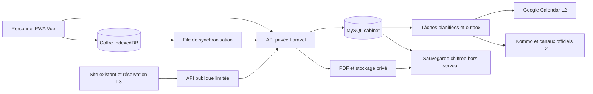

# Architecture technique

## Choix recommandé

Backend Laravel 13/PHP en API modulaire, PHP 8.4 recommandé et PHP 8.3 minimum, MySQL 8.4/InnoDB recommandé. Frontend Vue 3 + TypeScript + Vue Router + Tailwind CSS 4, construit avec Vite et servi en fichiers statiques sur le même hébergement web. PWA avec service worker Workbox via Vite PWA, base IndexedDB via Dexie, coffre local chiffré par Web Crypto. Aucun VPS ni serveur Node permanent.

Les factures, reçus et prescriptions sont produits en PDF côté client via jsPDF, y compris sans réseau. Modèles, fontes et logo sont préparés localement. Les originaux PDF sont synchronisés vers stockage privé ; le serveur vérifie les données et calculs de la pièce, puis conserve le PDF original avec son hash. Dompdf peut servir aux rapports serveur ultérieurs, sans être nécessaire à l’impression urgente hors-ligne.

Les prérequis Laravel et les bibliothèques sont vérifiés dans la documentation officielle au fichier 18. Les versions exactes sont verrouillées par Composer/npm au démarrage et testées ensemble. Ce choix répond à U : hébergement simple, design responsive et travail hors-ligne. La conformité de l’offre existante reste à vérifier.

Sessions, cache, jobs et outbox en base pour L0 ; workers courts via cron de l’hébergement web. Composer s’exécute dans un environnement compatible ; livrer `vendor/` construit en CI si le serveur n’a pas Composer/SSH. MySQL 8.0 existant peut être étudié après vérification des fonctionnalités, du support hébergeur et des tests ; MariaDB ne doit pas être déclaré compatible sans vérification.

## Organisation

```text
app/
  Domain/
    Patients/       actions, règles et projections
    Clinical/       consultations, mesures, prescriptions, versions
    Scheduling/     RDV, disponibilités, contrôles
    Billing/        factures, paiements, reçus, avoirs
    Inventory/      réservations, mouvements, lots, remises
    Workshop/       ordres et étapes atelier
    Communication/ consentements, tâches et envois
  Integrations/     contrats et adaptateurs Google/Kommo/Meta/SMS
  Http/Controllers/ API authentifiée et synchronisation
  Policies/         autorisation de chaque ressource/opération
  Jobs/            PDF, rappels, outbox, synchronisations
resources/frontend/
  pages/           écrans Vue et formulaires
  domain/          calculs purs et règles locales versionnées
  offline/         coffre, transactions, outbox et synchronisation
  documents/       PDF locaux et snapshots
  components/      composants ergonomiques accessibles
database/          migrations, factories fictives, seeders référentiels
tests/             tests domaine, intégration MySQL, navigateur
```

Ne pas placer les calculs dans un composant visuel ou un webhook. Le client exécute des règles pures versionnées ; le serveur réapplique les mêmes invariants à la synchronisation. Les deux implémentations utilisent les mêmes vecteurs de test JSON. Employer les outils Laravel/Vue standards ; pas de microservices, de nouveau CRM maison ou de Docker obligatoire.

## Flux système



Le site public n’accède pas à la base médicale et n’utilise pas la session du back-office. Pas de cookie partagé au domaine parent. Le sous-domaine de recette a sa base et ses secrets propres, avec comptes et données fictifs.

## Transactions et concurrence

Actions critiques : émission, encaissement, contre-écriture, avoir, remboursement, réservation, remise, mouvement validé et démarrage examen. Le chemin serveur utilise une transaction : autoriser, vérifier version/droit de poste, verrouiller, recalculer, créer écritures et audit/outbox, commit. Le chemin local emploie une transaction IndexedDB atomique sur documents, ressources allouées et journal de commandes. Les contraintes de poste, numéros et stock rendent la validation différée contrôlable ; fichier 19 obligatoire.

Verrous `SELECT ... FOR UPDATE` sur InnoDB, contraintes uniques de numéro/idempotence et ordre de verrouillage stable. Retenter les deadlocks de manière bornée avec la même clé d’action. Tests de concurrence sur MySQL réel ; SQLite seul n’est pas suffisant pour ces garanties.

Consultation et brouillon financier ont `version` pour verrouillage optimiste. Enregistrer avec une ancienne version retourne conflit, conserve le formulaire et permet consulter la version récente ; jamais écraser silencieusement l’autre opérateur. Une finalisation clinique crée un snapshot complet, auteur et date. Les écritures financières hors-ligne possèdent un seul poste propriétaire ; aucune écriture serveur concurrente n’est autorisée sur le même solde tant que ce droit n’est pas rendu.

## Documents et effets externes

PDF créé après commit local/serveur, conservé dans le coffre puis en privé sur serveur après synchronisation, avec hash, type, version de template et snapshot. Une panne PDF ne relance pas l’encaissement. La file locale de synchronisation est distincte de l’outbox serveur d’intégrations. Aucun SMS, WhatsApp ni appel Google ne se produit dans la transaction de paiement.

Chaque traitement est idempotent et journalise succès/échec. Le principe est une livraison des événements au moins une fois avec déduplication ; ne pas prétendre assurer exactement une livraison pour tous les fournisseurs. Un événement perdu chez un fournisseur sans retry impose une réconciliation périodique.

## Scheduler selon hébergement

Sur hébergement web simple compatible : cron minute `schedule:run` et worker court `queue:work --stop-when-empty` avec budget inférieur à la limite hébergeur, verrou sans chevauchement. Si la fréquence permise est 5/15 minutes, quantifier le retard des rappels et le documenter ; ne pas promettre H-2 à la minute. Le client synchronise au retour du réseau, au lancement, périodiquement quand ouvert et sur bouton ; il ne dépend pas d’un support universel de Background Sync.

L0 exige scheduler pour tâches serveur et sauvegardes, et stockage local persistant testé. Si cron ou accès sécurisé aux secrets manquent, étudier une offre web simple adaptée ; le VPS est exclu par U. N’exposer aucune URL publique « cron » sans authentification comme substitut improvisé.

## Performances et qualité

Index nom normalisé/téléphone/dossier, dates de visites, consultations patient, factures patient/statut/date, paiements facture/date, lots et jobs à échéance. Pagination 25 ou 50 lignes ; recherche catalogue limitée ; pas de chargement de tout l’historique en une réponse.

Cibles à mesurer sur serveur de recette : recherche patient <1 s côté serveur, ouverture d’une fiche <2 s au 95e percentile sous charge initiale convenue ; opérations critiques <2 s hors PDF. Hypothèse de dimensionnement de test : 20 000 patients, 100 000 consultations, 5–10 utilisateurs concurrents ; volumes réels à confirmer.

CI : formatage, analyse statique PHP/TypeScript, PHPUnit/Pest et Vitest, mêmes vecteurs métier PHP/TS, migrations, build PWA et Playwright avec réseau coupé/rétabli et deux contextes de postes. Les tests portent sur invariants, reprise après fermeture et synchronisation, pas uniquement sur l’existence des composants.

## Principes d’extension

Cabinet initial unique avec `clinic_id` sur les agrégats pour assurer cohérence et isolement ; aucun écran multi-cabinet requis. Tous les domaines sont modélisés dans le MCD/MLD et le SQL complet maintenant, y compris atelier, inventaires, CRM, campagnes et site. Les migrations applicatives suivent ce schéma intégral sans destruction ; les écrans/adaptateurs sont développés et activés selon le planning. Adaptateurs externes désactivés par défaut jusqu’à configuration réelle.

Le système clinique/financier est la source d’autorité. Kommo est maître des conversations commerciales ; Google fournit des indisponibilités et une représentation synchronisée des rendez-vous. Aucun connecteur ne peut confirmer un paiement ou modifier une prescription.
