# Modèle conceptuel de l'application entière

## Portée et lecture

Ce modèle définit dès maintenant le système complet : organisation, dossier patient, clinique, agenda, facturation, caisse, stock, achats, atelier, communication/CRM, intégrations, site public, fonctionnement hors-ligne et exploitation. L'urgence patient/facturation détermine l'ordre de réalisation ; elle ne réduit aucune entité ni relation du socle. Les fonctions planifiées pour les livraisons suivantes restent à coder, vérifier et activer.

Références : [sources et arbitrages](00-sources-et-arbitrages.md), [périmètre complet](01-perimetre-et-livraisons.md), [règles financières et stock](03-regles-finance-stock.md), [hors-ligne](19-hors-ligne-et-synchronisation.md), [modèle relationnel](20-modele-relationnel.md), [catalogue canonique des tables](../database/schema_catalog.json) et [schéma SQL complet](../database/01_schema.sql). Les noms métier français ci-dessous sont conceptuels ; leur traduction en tables, clés, types et contraintes figure dans le modèle relationnel. Les diagrammes séparés condensent les associations métier pour rester lisibles ; la correspondance exhaustive de fin de document couvre aussi les tables de sélection, référentiels et mécanismes techniques.

Dans les diagrammes Mermaid, `||` signifie exactement un, `o|` zéro ou un, `o{` zéro à plusieurs et `|{` un à plusieurs. Les cardinalités représentent les données autorisées, y compris les brouillons. Une facture brouillon peut n'avoir aucune ligne ; une facture émise en exige au moins une. Les règles de finalisation précisent ces minimums conditionnels.

Le cabinet est le périmètre d'appartenance des agrégats métier. Toutes les associations entre objets métier doivent rester dans le même cabinet. Le cabinet initial est unique, mais le modèle conserve cette frontière dans les clés et commandes. Les identifiants techniques sont stables, y compris après synchronisation ; les numéros affichés sont des identifiants métier distincts.

## Concepts à distinguer

| Concept | Signification | Conséquence de conception |
| --- | --- | --- |
| Patient | Identité durable d'une personne enregistrée au cabinet | Une identité alimente les visites, la clinique et la vente ; les téléphones partagés ne constituent pas un identifiant unique |
| Prospect | Contact commercial qui n'est pas nécessairement un patient | Aucun dossier clinique fictif ; rapprochement explicite si le prospect devient patient |
| Visite | Passage administratif horodaté : examen, achat, retrait ou suivi | Plusieurs visites possibles pour un patient ; un achat direct ne crée pas une consultation vide |
| Consultation | Examen humain rattaché à une visite | Chaque nouvelle consultation possède ses propres mesures, décisions et révisions |
| Prescription | Décision du professionnel, distincte des mesures | Une copie de réfraction est explicite ; les versions validées utilisées par l'atelier sont figées |
| Contrôle recommandé | Date souhaitée de suivi clinique | Ne réserve pas à lui seul un créneau |
| Rendez-vous | Créneau pour une prestation et une ressource | Possède ses états et versions ; une proposition hors-ligne attend confirmation |
| Facture | Créance émise pour prestations et articles | Identité, prix, taxes et lignes sont figés à l'émission |
| Paiement | Encaissement constaté sur une facture | Plusieurs acomptes/soldes possibles ; chaque confirmation possède son reçu |
| Reçu | Pièce d'un encaissement confirmé | Un reçu réimprimé ne crée jamais un nouveau paiement |
| Contre-écriture | Correction d'un encaissement saisi à tort | Préserve le paiement initial ; ne représente pas une sortie d'argent réelle |
| Avoir | Réduction d'une créance émise | N'efface ni facture ni livraison et ne remet rien en stock |
| Remboursement | Restitution réelle d'argent à partir d'un crédit disponible | Opération autorisée, numérotée et indépendante du retour physique |
| Réservation de stock | Allocation de quantités pour une vente | Réduit le disponible sans changer le physique |
| Livraison | Remise physique d'articles au patient | Consomme la réservation et provoque la sortie une seule fois |
| Retour physique | Reprise d'un article précédemment remis | Seul un retour accepté après contrôle produit une entrée de stock |
| Réception fournisseur | Entrée documentée de marchandise achetée | Coût/lot/quantité conservés ; validation produit les mouvements |
| Inventaire | Comparaison physique/théorique à une date | Les écarts validés produisent des ajustements, sans écraser le journal |
| Commande atelier | Fabrication/assemblage d'un équipement vendu | Référence la ligne et la version de prescription ; étapes et reprises conservées |
| Tâche de contact | Action humaine ou automatisée prévue | Échéance et source identifiées ; plusieurs tentatives conservées |
| Transmission | Tentative réelle vers un fournisseur externe | Soumission, livraison, lecture et état inconnu sont distincts |
| Approbation | Autorisation d'une action précise sur un contenu donné | Motif, empreinte, auteur, décision et consommation conservés |
| Commande de synchronisation | Fait local durable envoyé au serveur | Même identifiant au retry ; contenu initial conservé en cas de conflit |

## 1. Organisation, utilisateurs et identité patient

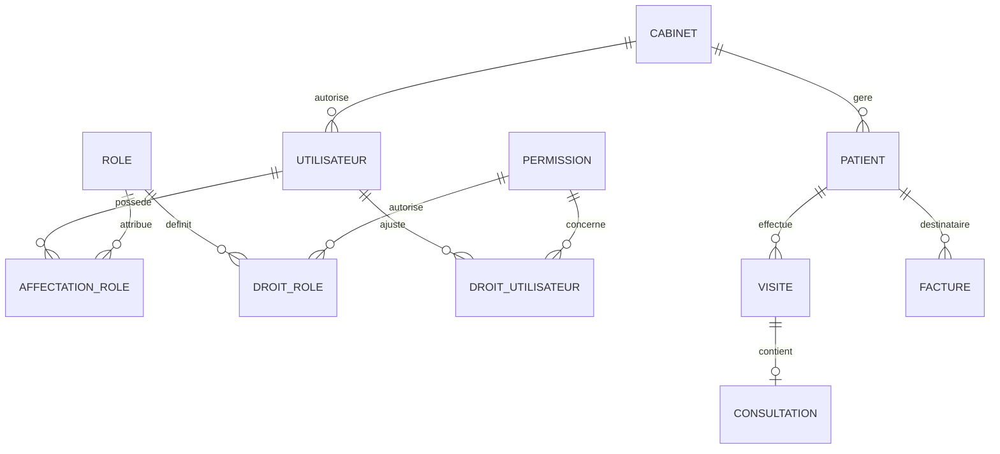

La date de naissance est une donnée source ; l'âge est calculé à la date demandée, sans colonne d'âge qui deviendrait périmée. Un téléphone secondaire, une raison de naissance/téléphone inconnus et un contact responsable éventuel complètent l'identité. La recherche s'appuie sur des valeurs normalisées, tout en conservant les valeurs originales utiles.

La détection de doublons ne fusionne aucune identité. Une fusion autorisée conserve patient source, patient cible, auteur, motif et identifiants antérieurs ; les documents émis conservent leur snapshot. L'archivage d'un patient ne supprime ni clinique ni écritures. Les rôles contrôlent les opérations et les champs exposés : avoir accès à une identité n'autorise pas à lire ses mesures ni les rapports financiers.

Une fusion possède un dossier source et un dossier conservé distincts ; un dossier source ne peut apparaître qu'une fois comme source de fusion. Le dossier conservé peut recevoir plusieurs dossiers rapprochés. La commande contrôle l'absence de cycle de fusion et préserve les correspondances historiques.

Une visite appartient à exactement un patient. Le modèle limite une consultation à une visite ; plusieurs examens distincts nécessitent plusieurs consultations/visites. La visite peut avoir un RDV d'origine et une facture de frais d'examen. La vérification de paiement ou la dérogation spécifique précède le démarrage de la consultation.

## 2. Consultation, mesures et prescriptions

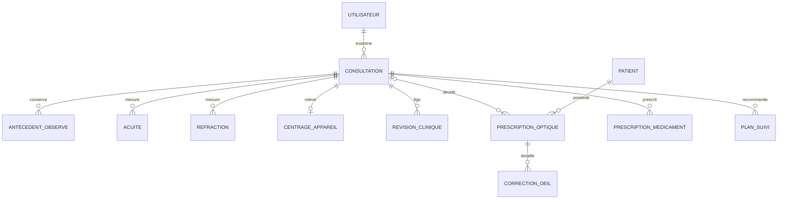

Les motifs multiples, antécédents oculaires/médicaux/familiaux, amétropies et motifs d'orientation proviennent de référentiels contrôlés ; `Autre` conserve une précision. L'absence de saisie reste inconnue, distincte d'`Aucun connu`, de `Non` et de zéro. Le groupe `Aucun connu` est exclusif des autres antécédents du même groupe.

L'acuité possède un contexte, une distance, une condition de correction, un œil, une échelle et une valeur originale. Le préliminaire autorise douze emplacements loin/près × sans/avec correction × OD/OG/OU. L'acuité après correction ajoute OD/OG/OU sans inventer une distinction loin/près absente du modèle fourni. Une conversion numérique éventuelle exige une règle validée ; deux échelles incompatibles ne sont pas agrégées.

La réfraction est séparée par étape autorefractomètre/objective/subjective et OD/OG. Sphère, cylindre, axe et addition ne sont jamais confondus avec la correction prescrite. Le centrage garde DP totale et/ou monoculaire, sans calcul artificiel d'une DP monoculaire à partir du seul total. La prescription conserve en outre usage, verre, indice, traitements et hauteur de montage par œil.

Une prescription optique appartient toujours à un patient et à une série de versions. L'origine interne exige sa consultation ; une ordonnance externe n'impose pas de consultation fictive et conserve prescripteur d'origine, date disponible et pièce justificative disponible. Elle est transcrite et validée par un professionnel habilité avant usage atelier. Les remplacements restent dans la même série et chez le même patient.

Une prescription possède au plus une ligne OD et une ligne OG ; l'unicité par œil limite donc à deux les lignes représentées par la cardinalité multiple du diagramme. Les mesures de réfraction suivent la même unicité par étape/œil. Les champs requis à l'impression dépendent des yeux concernés et de la mention explicite d'absence de correction.

Les médicaments possèdent des lignes distinctes avec nom, forme, dosage, posologie, fréquence, durée et instructions. Une ligne peut citer le catalogue ou conserver un médicament en texte libre. Prescrire ne facture ni ne décrémente une quantité. Conclusion, orientation et urgence appartiennent à la clinique ; une orientation ne remplace pas l'état d'avancement de la consultation.

La finalisation fige une révision complète, auteur, date et empreinte, contenant les données et prescriptions concernées. Une correction crée une révision justifiée. Une prescription validée utilisée dans un document ou une commande atelier garde sa version ; une nouvelle décision la remplace explicitement sans modifier l'ancienne.

## 3. Agenda, recommandations et relances

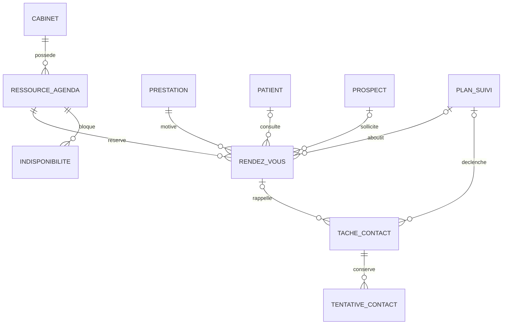

Un RDV dispose d'un contact identifié : patient ou prospect selon son origine, avec règle de cohérence appliquée par la commande. Les créneaux confirmés ont durée positive, prestation et ressource ; les plages sont demi-ouvertes `[début, fin)`. Horaires, indisponibilités et RDV actifs concourent à la disponibilité. Deux demandes web/WhatsApp/interne utilisent la même confirmation transactionnelle.

Un plan de suivi garde consultation source, patient, raison, date d'ancrage, délai, date recommandée et provenance du calcul. Les délais civils en mois/années ne deviennent pas des durées fixes en secondes. Après collyre, le professionnel choisit le point de départ et la durée ; aucune déduction médicale automatique.

Une politique de rappel crée des tâches identifiées par source/version/échéance/canal. Une modification de RDV rend obsolètes les tâches anciennes ; l'envoi vérifie la version juste avant transmission. Contacté, RDV pris, sans réponse, refus et report sont historisés par tentative. Le modèle conserve les tentatives humaines même lorsque le canal souhaité est WhatsApp ou SMS.

Une tâche possède exactement une source typée : plan de suivi, RDV, facture pour relance de gestion, ou commande atelier pour disponibilité. Elle possède exactement un destinataire patient ou prospect. La politique est facultative pour une tâche créée manuellement ; échéance, version source et clé de déduplication restent explicites.

Les propositions locales restent à confirmer avant d'occuper l'agenda global. Google représente les RDV et fournit des indisponibilités ; aucun motif médical détaillé n'est nécessaire à cette représentation.

## 4. Vente, créances et pièces financières

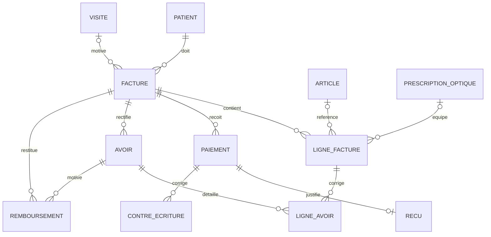

Chaque facture a un patient ; la visite est facultative, notamment pour une reprise documentée. Les lignes peuvent référencer un article du catalogue ou une ligne libre exceptionnellement autorisée. À l'émission, facture et lignes gardent snapshots d'identité, cabinet, référence, désignation, unité, prix/remise et taxe. Un changement du catalogue ou du patient ne réécrit pas une facture émise.

Un paiement confirmé possède exactement un reçu numéroté ; l'absence de PDF disponible ne retire pas le reçu ni le paiement. Les soldes sont calculés depuis les écritures. Une facture neutralisée par avoir conserve son émission, ses paiements, ses reçus et son historique. Les avoirs et contre-écritures sont positifs et explicitement liés aux écritures initiales ; ils ne sont jamais des suppressions.

Une reprise de solde papier conserve référence d'origine, total historique, déjà réglé, créance restante, justificatif et validation. La facture de reprise représente uniquement le solde à recouvrer, exclu du CA courant ; elle ne simule aucun ancien paiement encaissé aujourd'hui.

Le devis est une possibilité déjà décrite dans le socle, activée si retenue : lignes proposées, validité et conversion explicite en facture. Un devis ne constitue ni créance émise, ni paiement, ni réservation définitive implicite. La conversion copie les données validées et conserve le lien d'origine.

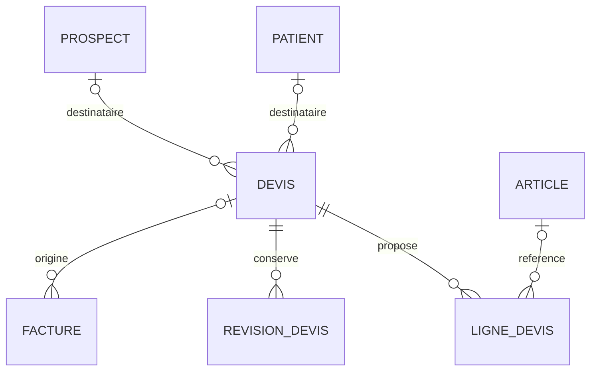

Un devis vise exactement un patient ou un prospect, jamais les deux. Une version remise/corrigée est figée. L'action de conversion contrôle le destinataire, les prix et l'absence de conversion accidentelle répétée ; les clés de facture et devis gardent l'origine sans réécrire le devis comme une vente.

## 5. Sessions de caisse et rapprochements

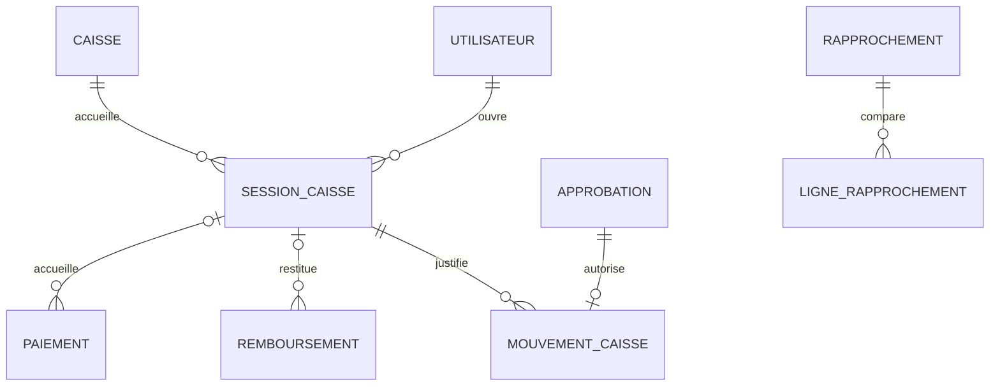

La session enregistre ouverture, fonds initial, clôture, montant attendu, comptage, écart et justification. Paiements et remboursements espèces contribuent à sa projection ; ils ne sont pas copiés en mouvements de caisse. Les mouvements couvrent dépôts, retraits, dépenses et corrections autorisées, avec catégorie et justificatif lorsque prévu.

Le rapprochement distingue espèces, mobile money et banque. Une confirmation manuelle d'encaissement ne devient pas une preuve fournie par l'opérateur télécom. Les écarts et leur résolution restent identifiables. Les informations destinées au comptable sont des exports de gestion ; aucune comptabilité réglementaire complète n'est présumée.

## 6. Catalogue, stock, réservations et remise

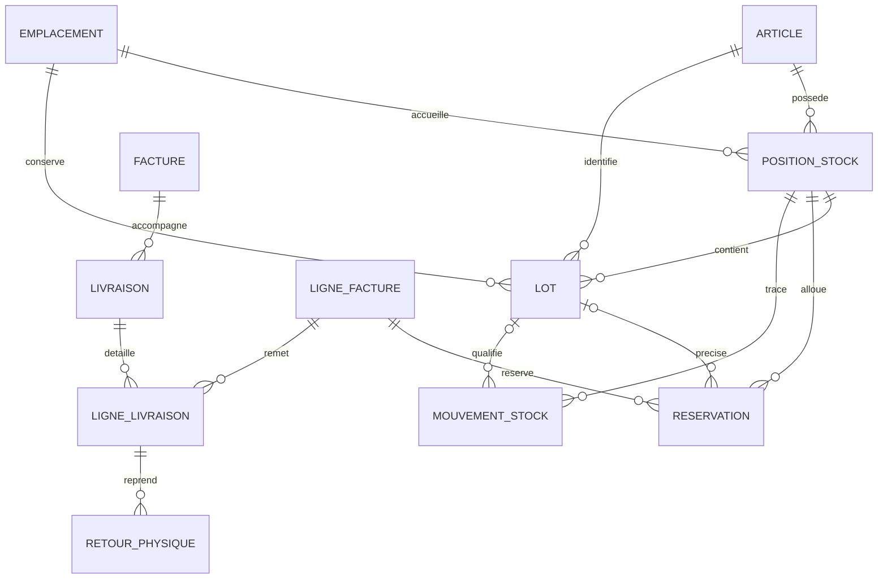

Une position correspond à un article et un emplacement. Les lots apportent péremption, coût et statut vendable/quarantaine. L'unité du catalogue détermine la quantité de stock : une paire n'est pas décrémentée comme deux unités sans conversion explicitement configurée. Les prestations, articles stockés et équipements fabriqués à la commande possèdent des modes distincts.

Le mouvement stock est le journal ; les positions et soldes de lots sont des projections transactionnelles vérifiables. La réservation est une quantité allouée, dont une partie peut être consommée ou libérée. Elle ne représente pas une sortie physique. La livraison référence les lignes de la facture correspondante ; sa confirmation provoque la sortie et la consommation de réserve au même commit.

Le retour référence une livraison précise et garde quantité, état et acceptation. Un avoir associé n'est pas obligatoire pour une reprise physique et ne provoque pas lui-même une entrée. Sorties de casse, retour fournisseur et ajustement portent motif et autorisation. Les lots expirés sont bloqués même sans Internet.

## 7. Fournisseurs, achats, réceptions et inventaires

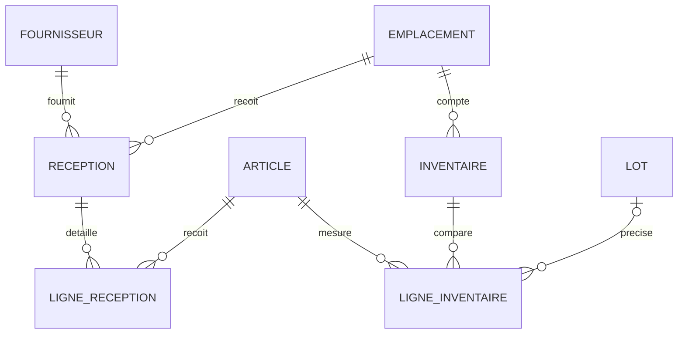

Un fournisseur peut livrer en plusieurs réceptions documentées. La réception est l'objet de gestion d'achat retenu dans le socle : elle garde fournisseur, référence de livraison, emplacement, justificatif, coût et validation, sans inventer un cycle supplémentaire de bons de commande. Les lignes conservent quantités, unités, prix/coûts et lots ; la validation alimente le stock une seule fois. Les réceptions ne sont pas confondues avec les commandes verrier.

L'inventaire possède un périmètre et un instant de référence. Les lignes gardent théorique figé, quantité comptée, différence et justification. La validation autorisée produit des mouvements d'ajustement auditables, sans remplacer arbitrairement le stock calculé. Seuils et péremptions produisent alertes/tâches à partir des données réelles ; un coût inconnu n'est pas remplacé par zéro.

## 8. Atelier et équipements

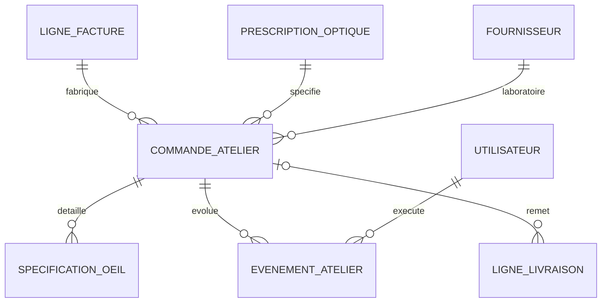

La commande conserve patient indirectement via sa facture, référence de vente, prescription validée exacte, monture et caractéristiques des verres OD/OG, laboratoire, dates, échéance et observations de fabrication. Les informations nécessaires au bon labo sont figées dans la commande sans dépendre d'une prescription qui changerait ensuite.

Commandé, réceptionné, taillage/montage, contrôle qualité, prêt et livré/ajusté décrivent le travail. Les reprises et contrôles sont des événements, avec auteur et heure. Une livraison est une remise au patient ; réceptionner des verres de laboratoire ne la remplace pas. Le passage prêt peut déclencher une tâche de notification administrative unique pour la version concernée.

## 9. CRM, consentements, assistant et campagnes

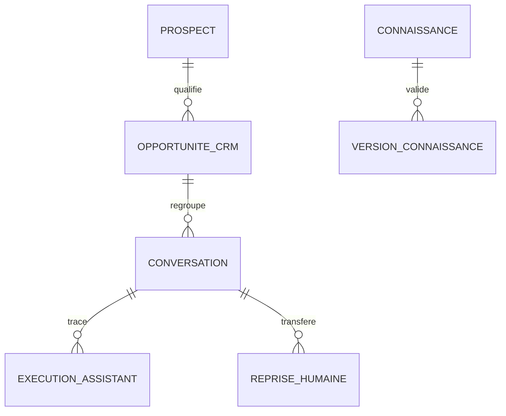

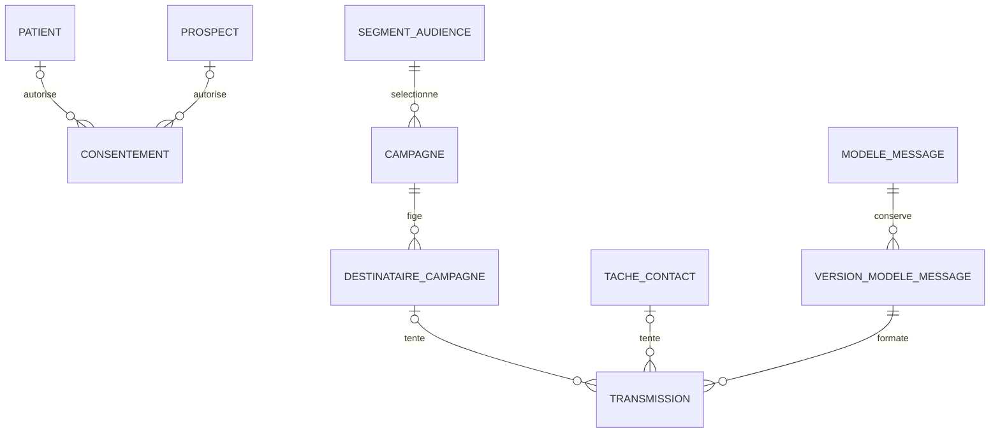

Kommo conserve l'autorité sur les conversations commerciales. Le socle local définit identités de liaison, correspondances, état de reprise humaine, contenus autorisés et suivi nécessaire à l'automatisation ; il ne devient pas un second CRM autonome à ressaisir. Les données techniques de synchronisation sont séparées des données cliniques.

Les consentements sont datés et prouvés, par personne/contact, canal, finalité et coordonnées concernées. Un retrait stoppe les envois correspondants. Un changement de téléphone ne transfère pas silencieusement le consentement. Les destinataires d'une campagne sont figés après validation et contrôlés de nouveau avant envoi.

L'assistant répond depuis des contenus commerciaux validés/versionnés : horaires, localisation, tarifs publics, services, technologies, qualification et disponibilités. Les réponses cliniques, prescriptions et encaissements ne sont pas ses pouvoirs. Reprise humaine active suspend les réponses automatiques ; le résumé de transfert reste administratif.

La transmission garde fournisseur, destinataire protégé, modèle/version, clé de déduplication, identifiant fournisseur éventuel, états et erreurs. Timeout après soumission peut laisser l'état inconnu. Dédupliquer une tâche interne ne garantit pas qu'un fournisseur dépourvu d'idempotence n'enverra jamais deux messages : la réconciliation complète le contrôle.

## 10. Site public, showroom et réservation

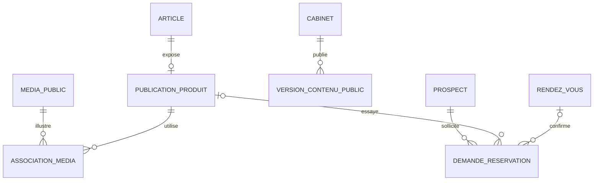

Le showroom publie seulement les références et médias approuvés : montures optiques/solaires, styles, marques et contenus dermocosmétiques. Prix d'achat, stock détaillé, identités et historique médical ne sont jamais des champs publics. Une publication de produit référence le catalogue métier ; elle ne crée pas un stock ou un prix indépendant sans règle explicite.

Le formulaire public collecte le minimum administratif, choisit prestation/créneau et transmet une demande au même agenda que le cabinet et WhatsApp. Le bouton « Essayer ce modèle » conserve la publication produit sélectionnée sur cette demande lorsqu'elle provient du showroom. La confirmation utilise les règles globales ; une demande publique ne confirme pas un paiement et ne fabrique pas une consultation. Le site existant et l'application privée gardent des sessions distinctes.

## 11. Intégrations et effets externes

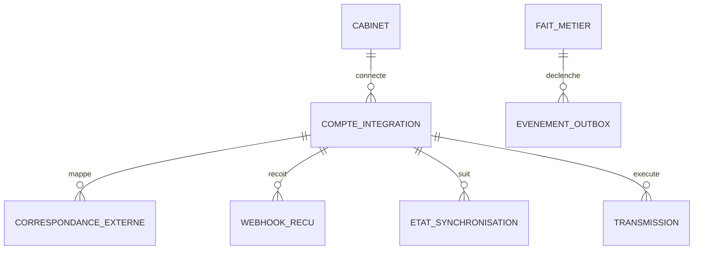

Les associations externes conservent fournisseur/compte, type et identifiant local, type et identifiant externe, version/etag et date de synchronisation. Lorsque l'association cible plusieurs types métier, l'application vérifie existence, cabinet et type au lieu de prétendre disposer d'une FK SQL universelle.

L'inbox de webhook persiste, valide et déduplique les événements reçus avant traitement. L'outbox matérialise les effets à effectuer après commit d'une écriture métier. Le réseau externe n'appartient pas à la transaction MySQL : retry, backoff, identifiant stable et réconciliation sont indispensables.

Les curseurs calendaires, échéances de renouvellement, erreurs et états fournisseur permettent la supervision. Les secrets sont chiffrés ou maintenus dans une configuration privée dédiée ; les journaux ne les contiennent pas. L'hébergement web simple utilise des tâches courtes via cron/queue en base, sans VPS ni Node permanent.

## 12. Autorisations hors-ligne et consolidation

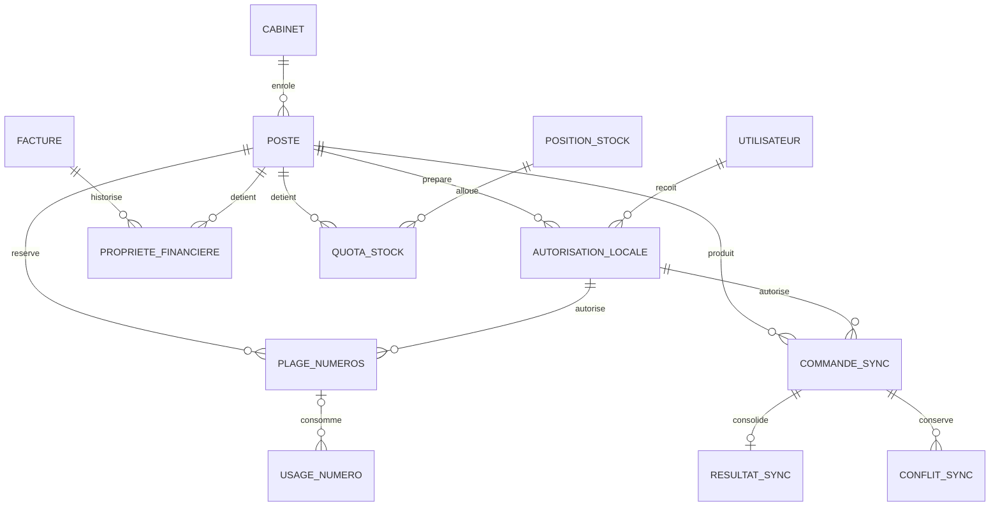

L0 opère avec un poste principal de caisse préparé, doté d'autorisations utilisateur, numéros et stock. Les autres postes peuvent saisir leurs dossiers autorisés ; les nouvelles données de deux postes totalement déconnectés ne deviennent pas visibles l'une à l'autre sans transfert contrôlé.

Une facture possède **au maximum un droit financier actif**, indépendant de la durée de l'autorisation utilisateur. Les droits historiques peuvent être multiples, avec epoch et clôture documentée. Tant qu'un poste possède le droit, les écritures concurrentes sur la même facture sont bloquées ; restitution/transfert nécessitent reprise complète des commandes. L'expiration d'un grant ne rend pas les numéros, factures ou quotas automatiquement disponibles.

Une plage contient des numéros disjoints attribués par cabinet/type/année ; un numéro local émis reste définitif. Un quota de stock retranche du disponible des autres postes les unités réservées au poste, sans les retirer du stock physique. Une réserve locale sous quota et sa sortie ne sont pas décomptées deux fois.

La commande garde ID, poste/séquence, utilisateur/autorisation, versions de règles et de schéma, dates locale/serveur, hashes/signature et payload protégé. Le serveur applique ordre et idempotence, puis répond par ACK durable. Les conflits conservent la proposition originale et une résolution explicite. La clinique n'emploie pas « dernier écrit gagne ».

IndexedDB contient une projection locale minimale chiffrée par profil : entités de travail, ressources allouées, pièces/PDF, commandes et ACK. Elle n'est ni une copie librement modifiable du serveur, ni une deuxième base clinique indépendante. La transaction locale écrit ensemble fait métier, consommation des ressources et journal. Les exports chiffrés et tests de restauration protègent les pièces non encore consolidées.

## 13. Documents, audit, approbations et exploitation

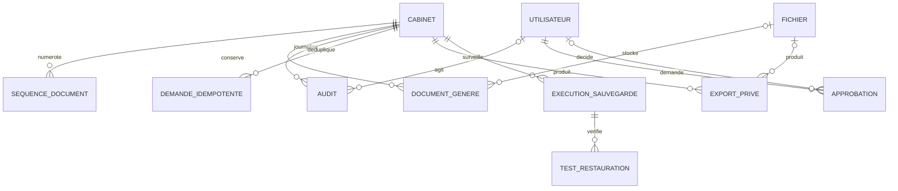

Une pièce générée référence type/source/révision, template et fichier privé avec empreinte ; son snapshot provient de l'objet métier figé. Les références de source sont des FK explicites et exclusives : facture, reçu, avoir, remboursement, prescription, révision clinique, commande atelier, patient pour relevé ou devis. La commande contrôle que le type du document correspond à sa source. Avant génération réussie, le fichier peut être absent. Un fichier ne remplace pas l'objet métier et son snapshot ; une panne de génération ne répète pas l'opération financière.

L'approbation porte action, cible, contenu/empreinte, demandeur, motif, décision et consommation unique. Le journal garde auteur, heure, action, cible et différences filtrées sans secrets. Les actions système ont une provenance explicite. L'idempotence distingue même commande/même contenu de même clé/contenu différent.

Les exports et sauvegardes sont datés, privés et autorisés, avec résultats d'exécution consultables. Une entrée « sauvegarde réussie » ne démontre pas une restauration : celle-ci doit être testée selon les procédures d'exploitation. La formation métier, la configuration des emails et l'accompagnement vidéo sont des livrables du projet sans tables métier artificielles.

## Invariants qui traversent les domaines

| Invariant | Contrôle attendu |
| --- | --- |
| Appartenance au cabinet | FK composites lorsque définies ; politique et commande sur toutes les cibles polymorphes et exports |
| Identité cohérente | Patient d'une facture = patient de sa visite ; patient d'un suivi/RDV/consultation cohérent avec sa source |
| Consultation distincte | Une nouvelle visite clinique ne remplace pas l'examen précédent ; corrections et finalisations versionnées |
| Mesure/prescription distinctes | Aucune copie implicite, aucune conversion clinique silencieuse ; null/inconnu distinct de zéro |
| Frais d'examen | Facture pertinente soldée par paiements confirmés ou dérogation spécifique avant démarrage |
| Émission financière | Pièce numérotée et snapshot figé ; correction par avoir/contre-écriture/remboursement selon sa nature |
| Soldes exacts | Total lignes, avoirs, paiements nets et remboursements calculés en arithmétique exacte ; contrôles transactionnels |
| Quantités corrigées/remises | Cumul avoirs/livraisons/retours compatible avec les lignes initiales ; mêmes facture/article/lot aux associations |
| Stock disponible | Physique moins réserves centrales et quotas résiduels ; aucune sortie double entre réservation, remise et sync |
| Sécurité des lots | Lot requis lorsque nécessaire, statut vendable et péremption contrôlés à la date de remise |
| Approbation sensible | Permission serveur/local, contenu inchangé, raison, décision et consommation unique |
| Version atelier | Prescription validée précise, interne ou externe, conservée sur la commande et le bon labo ; même patient que la facture |
| Disponibilité agenda | Confirmation sous verrou ; propositions locales et événements Google incertains restent identifiés |
| Consentement et confidentialité | Coordonnées/finalité/canal autorisés avant chaque envoi ; aucune donnée clinique superflue hors du domaine |
| Hors-ligne durable | Ressources pré-allouées, droit financier unique, commande signée durable, ACK et conflit conservés |
| Effets externes | Après commit central uniquement, outbox/idempotence/réconciliation ; échec externe ne supprime aucun fait métier |
| Conservation | Pas de suppression en cascade des données finalisées/émises ; archivage et procédures de conservation dédiées |

Le SQL impose les structures, unicités, bornes et associations qui y sont déclarées. Les sommes entre lignes, transitions d'état, créneaux concurrents, autorisations et cohérences multisources ne sont pas toutes exprimables par une FK ou un CHECK : les commandes applicatives transactionnelles les rendent effectives. Les gardes d'historique constituent une protection supplémentaire, à associer à des privilèges DB minimaux et aux sauvegardes.

## États et projections

| Objet | Dimensions à conserver | Interprétation |
| --- | --- | --- |
| Visite | Arrivée, attente frais, prête examen, en consultation, terminée, annulée | Le passage prêt/en consultation dépend de la règle d'examen |
| Consultation | Brouillon, en cours, terminée ; orientation et suivi séparés | « À revoir », « orienté », « RDV programmé » sont des badges dérivés compatibles |
| Prescription | Brouillon, validée ; version précédente référencée | Une ordonnance validée n'est pas éditée en place |
| Suivi | Actif, programmé, clos, annulé | Programmé exige un RDV actif lié, sans supprimer la recommandation |
| RDV | À confirmer, confirmé, arrivé, terminé, annulé, absent | Créneau déplacé = nouvelle version de programmation |
| Facture/avoir | Brouillon, émis, abandonné | Une facture émise neutralisée conserve son émission |
| Règlement facture | Non payé, partiel, soldé, crédit à rembourser | Projection des écritures ; aucune édition directe du solde patient |
| Paiement | En attente, confirmé, rejeté | Confirmation produit reçu ; correction par écritures distinctes |
| Stock | Journal des mouvements ; projections physique/réservé/disponible | Une projection corrigée exige un mouvement justifié |
| Livraison | Brouillon puis confirmée | Confirmée = fait physique ; le retour est une nouvelle opération |
| Atelier | Commande, réception, montage, contrôle, prêt, livraison et reprise | Historique auteur/date de chaque étape |
| Conversation | Automatisation active, reprise humaine, reprise explicite | Reprise humaine suspend les réponses du bot |
| Transmission | Planifiée, soumise, livrée, lue, échec, inconnue, annulée | Soumission ne prouve pas réception |
| Commande locale | En attente, acceptée, déjà acceptée, dépendance manquante, conflit | Original et décisions conservés ; retry garde le même ID |

Les libellés exacts stockés et leurs contraintes sont définis par le [modèle relationnel](20-modele-relationnel.md) et le SQL canonique. Ce tableau expose les dimensions métier ; il ne permet pas d'inventer un état absent du contrat.

## Reporting sans seconde vérité

Patients du jour, consultations, nouveaux/anciens patients, motifs, orientations, prescriptions, contrôles et RDV sont calculés à leur grain propre. Une correction d'examen ne crée pas une consultation statistique supplémentaire. Date de création administrative et première visite réelle restent distinctes lors d'une reprise.

CA et encaissements sont des indicateurs différents ; le règlement aujourd'hui d'une ancienne créance augmente les encaissements d'aujourd'hui. Les créances et crédits à rembourser restent séparés. Coûts ou âges inconnus sont affichés comme inconnus. Un tableau distant indique les postes non synchronisés ; ses totaux ne peuvent inclure leurs opérations encore locales.

## Correspondance avec le schéma relationnel complet

Les **117 tables des 14 domaines** sont couvertes ci-dessous. Les référentiels partagés sont distingués des objets appartenant au cabinet ; les tables de liaison donnent une représentation normalisée aux sélections et cardinalités multiples. Ce classement ne porte aucun jalon de livraison.

| Domaine | Concepts représentés | Tables canoniques |
| --- | --- | --- |
| Référentiels globaux | Cabinet et paramètres, profils/droits, lexique clinique, catégories et unités | `clinics`, `roles`, `permissions`, `role_permissions`, `clinical_terms`, `catalog_categories`, `units` |
| Accès et gouvernance | Comptes, affectations/dérogations de droits, approbations, audit et idempotence | `users`, `user_roles`, `user_permissions`, `approvals`, `audit_events`, `idempotency_requests` |
| Documents et exploitation | Fichiers, séquences et usages de numéros, PDF, exports, sauvegardes et restaurations | `stored_files`, `document_sequences`, `document_number_usages`, `generated_documents`, `export_requests`, `backup_runs`, `restore_tests` |
| Patients et clinique | Identité/fusion, passages, examens, sélections cliniques, mesures, révisions et ordonnances | `patient_records`, `patient_merges`, `visits`, `consultations`, `consultation_complaints`, `consultation_histories`, `consultation_history_terms`, `consultation_ametropias`, `consultation_referral_reasons`, `visual_acuity_scales`, `visual_acuities`, `refraction_measurements`, `autorefractor_centering`, `clinical_revisions`, `optical_prescriptions`, `optical_prescription_eyes`, `optical_prescription_treatments`, `medication_orders` |
| CRM et assistant | Prospects, opportunités Kommo, conversations/reprises, connaissances et exécutions de l'assistant | `prospect_contacts`, `crm_leads`, `crm_conversations`, `conversation_handoffs`, `knowledge_entries`, `knowledge_entry_versions`, `assistant_runs` |
| Agenda et suivi | Ressources/prestations, horaires/exceptions, créneaux, indisponibilités et recommandations | `scheduling_resources`, `appointment_services`, `resource_opening_hours`, `resource_exceptions`, `appointments`, `calendar_blocks`, `follow_up_plans` |
| Catalogue et facturation | Taxes/catalogue, devis/révisions, factures/lignes, encaissements/pièces/corrections et créances reprises | `tax_rules`, `catalog_items`, `quotes`, `quote_lines`, `invoices`, `invoice_lines`, `payments`, `receipts`, `payment_reversals`, `credit_notes`, `credit_note_lines`, `refunds`, `legacy_balance_imports`, `quote_revisions` |
| Caisse et rapprochement | Caisses physiques, sessions, catégories/mouvements et rapprochements de canaux | `cash_registers`, `cash_sessions`, `expense_categories`, `cash_movements`, `payment_reconciliations`, `payment_reconciliation_lines` |
| Stock achats et inventaires | Emplacements, fournisseurs, réceptions/lignes, positions/lots, inventaires, réserves, livraisons/retours, mouvements et alertes | `stock_locations`, `suppliers`, `goods_receipts`, `stock_positions`, `stock_lots`, `goods_receipt_lines`, `inventory_counts`, `inventory_count_lines`, `stock_reservations`, `deliveries`, `delivery_lines`, `physical_returns`, `stock_movements`, `stock_alerts` |
| Atelier optique | Commandes labo, spécifications OD/OG et événements de production/qualité/reprise | `workshop_orders`, `workshop_order_eyes`, `workshop_events` |
| Intégrations | Comptes fournisseurs, correspondances, état Google, inbox de webhooks et outbox | `integration_accounts`, `external_links`, `calendar_sync_states`, `webhook_inbox`, `outbox_events` |
| Communications et relances | Politiques/tâches/tentatives, consentements, modèles/versions, segments, campagnes/cibles et transmissions | `reminder_policies`, `contact_tasks`, `contact_attempts`, `communication_consents`, `message_templates`, `message_template_versions`, `audience_segments`, `campaign_definitions`, `campaign_recipients`, `message_attempts` |
| Showroom et réservation publique | Publications produit, médias, versions de contenus et demandes de réservation | `catalog_publications`, `catalog_media`, `public_contents`, `public_booking_requests` |
| Hors-ligne et synchronisation | Postes/grants, plages, propriétaire financier, quotas, commandes/ACK/conflits et pull | `enrolled_devices`, `offline_grants`, `document_number_allocations`, `invoice_write_owners`, `device_stock_allocations`, `sync_commands`, `sync_command_results`, `sync_conflicts`, `sync_change_log` |

Le [modèle relationnel](20-modele-relationnel.md) fournit les attributs et clés de chaque table ; le [dictionnaire](07-dictionnaire-donnees.md) précise les champs. Les [invariants de base de données](21-invariants-base-donnees.md) répartissent les garanties SQL et les responsabilités applicatives. Toute évolution modifie ces documents et le catalogue ensemble, sans schéma local ou connecteur divergent.

