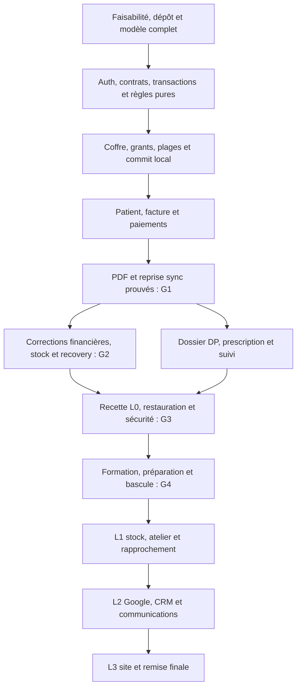

# Plan de développement détaillé pour Claude

Version 3.0, 14 octobre 2026. Ce plan transforme le socle complet en travaux exécutables. Il couvre les 117 tables et toutes les exigences EE001–EE046. L0 reste la priorité sous deux semaines ; L1–L3 sont planifiés maintenant. Aucun développement applicatif n’est déclaré réalisé par ce document.

## Documents d’exécution

| Document | Rôle pendant le codage |
| --- | --- |
| [23 Contrats d’ingénierie](23-contrats-ingenierie.md) | Décisions d’implémentation à appliquer sans refaire l’architecture |
| [24 Tâches détaillées](24-taches-developpement.md) | Fiches exécutables, fichiers attendus, dépendances, critères de sortie |
| [Backlog JSON](developpement/backlog.json) | Même backlog exploitable par un agent et outil de suivi |
| [25 Validation et bascule](25-validation-et-bascule.md) | Tests, preuves, gates et procédure de livraison |
| [Journal à initialiser](developpement/JOURNAL.md) | État durable permettant de reprendre sans réexaminer tout le projet |
| [16 Prompt Claude](16-demarrer-dans-Claude.md) | Consigne de lancement prête à copier |

Le fichier 13 présente les échéances ; les fichiers 22–25 prescrivent l’exécution. Les fonctionnalités, calculs, permissions et contraintes restent ceux des fichiers 02/03/08/09/19/21. En cas de contradiction réelle, préserver les règles métier et la sécurité, documenter l’écart et corriger les documents concernés ensemble. Une décision technique de ce plan n’invente pas une exigence du cabinet.

## Résultat final attendu

Un seul dépôt contient le backend Laravel, la PWA Vue, les migrations complètes, les référentiels, les règles PHP/TypeScript, les tests, les modèles PDF et les procédures d’installation. La base représente immédiatement tous les domaines ; l’activation des écrans et des connecteurs suit les lots. Les modules futurs n’apparaissent pas en menus vides.

Une tranche finie traverse formulaire → règle locale → stockage durable → document éventuel → synchronisation → action serveur → historique → test. Le code n’est pas organisé en une longue phase « tous les endpoints », puis « tous les écrans », puis « ajouter le hors-ligne ».

La première tranche prioritaire est : enrôler/préparer le poste → créer un patient → créer/émettre une facture → acompte et reçu → solde et reçu → imprimer hors-ligne → fermer/rouvrir → synchroniser et rejouer sans doublon. Elle utilise les services de production en construction et des données fictives, avec le même contrat que le produit final.

## Décisions prises pour démarrer

| Sujet | Choix d’exécution |
| --- | --- |
| Application | Monolithe modulaire Laravel 13, PHP 8.4 cible, MySQL 8.4 ; mêmes origines pour SPA et API |
| Interface | Vue 3, TypeScript strict, Vue Router, Tailwind 4 ; composants métier sobres, sans construire un design system générique |
| Authentification | Session Laravel/Sanctum SPA, CSRF, comptes nominatifs ; aucun bearer permanent stocké dans la PWA |
| Données | Catalogue canonique existant ; migrations fidèles de tout le schéma avant multiplication des modules |
| Règles | Fonctions pures PHP/TS avec vecteurs communs ; DTO explicites ; autorité serveur et autorisations locales bornées |
| Hors-ligne | Dexie, coffre chiffré et journal de commandes ; une caisse financière principale ; sync au profil ouvert |
| Documents | jsPDF local, fontes intégrées, snapshots et PDFs conservés ; génération séparée de l’encaissement |
| Tâches serveur | Base de données, cron et workers courts ; connecteurs externes derrière adaptateurs désactivés |
| Déploiement | Hébergement web PHP classique compatible ; build Node en développement/CI uniquement |
| Tests | PHPUnit, Vitest et Playwright ; MySQL réel pour schéma, transactions et concurrence |

Les versions mineures et dépendances exactes sont verrouillées au ticket F02 après vérification de compatibilité. Aucun changement de framework, base ou protocole pour une préférence personnelle. Un écart nécessaire produit une décision datée avec tests/impacts ; aucun nouveau chantier d’architecture sans besoin constaté.

## Ordre de travail obligatoire

1. Lire CLAUDE.md, 00/01/03/05/08/09/15/19/21, puis 22/23/25. Consulter 06/07/20 au niveau des agrégats travaillés. Initialiser le journal et le statut des tâches, sans réécrire les sources.
2. Exécuter F01–F03 : faisabilité, dépôt, compilation, CI minimale et base MySQL isolée. Commencer l’audit hébergement en parallèle de la préparation locale, sans en faire un prétexte pour attendre des accès.
3. Exécuter F04 : toutes tables, FK, CHECK, référentiels, vues et guards ; produire le rapport d’équivalence avec le SQL. Ajouter seulement les tables techniques Laravel documentées.
4. Construire F05–F10 puis O01–O04 : identité, contrats, transaction centrale, règles pures, coffre, enrôlement, ressources et commit local. Ces briques servent directement à la tranche urgente.
5. Construire P01/P02, B01–B05, I00, O05 et D01 pour la preuve G1. I00 fournit la réservation de stock avant l’émission, même si les écrans stock sont complétés ensuite. Les écrans restent courts mais utilisables ; la preuve est obtenue avant développement clinique étendu.
6. Compléter le bloc financier B05–B08, les impressions D02, les garanties O06/O07 et le stock I01/I02. Le parcours de paiement et de reprise passe G2.
7. Développer P03, C01–C04 et S01/S02 : tous les champs DP, historique, prescriptions, agenda et tâches internes. P04 contrôle le transport entre profils autorisés ; aucun partage involontaire du coffre.
8. Ajouter R01/R02, X01–X03, U01, G3/G4 et H01. Faire la recette, corriger les défauts et préparer la bascule ; aucun critère critique repoussé silencieusement.
9. Exécuter L1, puis L2 et L3 selon le graphe, en conservant les fournisseurs simulés tant que comptes/consentements ne sont pas prêts. Les tables et contrats sont déjà présents.

Le backlog JSON fixe l’ordre complet et les dépendances directes. Certaines tâches se chevauchent en pratique dans une même tranche, mais les critères de sortie de leurs prérequis doivent être acquis avant validation. Cette instruction ne suppose pas plusieurs développeurs ou agents parallèles.

Le backlog initial contient 79 tâches, dont 52 pour L0 et ses gates. [Le rapport de cohérence](developpement/validation-plan.json) contrôle dépendances, couverture et conservation du SQL validé. Il ne prouve pas la faisabilité du délai ni l’exécution des tests applicatifs futurs.

## Jalons et chemin critique

| Gate | Preuve exigée | Travaux qui attendent cette preuve |
| --- | --- | --- |
| G0 | Projet compilable, MySQL complet équivalent, configurations séparées | Aucune mutation réelle ni import de données du cabinet |
| G1 | Patient/facture/acompte/solde/PDF persistants hors-ligne, reprise rejouable | Multiplication des écrans et activation financière |
| G2 | Plafonds, approbations, stock/numéros, concurrence et recovery maîtrisés | Recette financière et bascule |
| G3 | Tous scénarios L0, droits/PDF et restaurations passés avec preuves | Ouverture aux opérations réelles |
| G4 | Paramètres réels, postes préparés, formation, rapprochement et décision de bascule | Déclaration de première livraison opérationnelle |
| G5 | Stock/atelier/rapprochement L1 reçus | Notification atelier et rapports avancés présentés comme livrés |
| G6 | Intégrations L2 testées sur comptes autorisés et reprise humaine démontrée | Envois/automatisations réels et réservation publique connectée |
| G7 | Site, propriété/export, documentation et remise finale vérifiés | Clôture technique du périmètre global |

G1 est une preuve technique ciblée et ne vaut pas recette L0. G0 comprend le modèle entier ; il ne signifie pas que les 117 tables disposent déjà d’écrans CRUD.

## Cible des deux premières semaines

J1–J10 ci-dessous désignent des jours de travail, environ quatorze jours calendaires à partir d’un démarrage convenu. C’est une répartition cible, pas une addition artificielle d’estimations indépendantes ni une promesse de débit d’un agent. Mesurer le temps réel sur G1 et mettre à jour le calendrier à J2 puis J4.

| Jour | Priorité et résultat démontrable | Contrôle du planning |
| --- | --- | --- |
| J1 | F01–F04 : dépôt, build, MySQL complet ; démarrer F05/F06 et O01 | Audit local acquis ; demandes Q01–Q04/Q14 consignées |
| J2 | Services minimum F07–F10/O02–O05 et tranche P01/B01–B05/I00/D01 ; preuve G1 visée | Si la preuve n’est pas obtenue, annoncer immédiatement risque/date recalculée |
| J3 | Terminer G1 si nécessaire ; B05/B06, I01 et D02 | Patient → facture → deux reçus vérifiables, online et offline |
| J4 | B07/B08/I02/O06/O07 ; G2 et impression réelle | Réestimer capacité restante, sans retirer D06 ou des règles financières |
| J5 | P02–P04/C01/C02 : accueil et examen DP complet | Champs/permissions/profils réellement traversés |
| J6 | C03/C04 : versions, prescriptions, médicaments et PDF clinique | Pas d’écrasement ; tests des champs DP et finalisation |
| J7 | S01/S02/R01/R02 : agenda, contacts internes, caisse et tableaux | Rappels externes toujours désactivés ; données incomplètes signalées |
| J8 | X01–X03/U01 : reprise papier, exports, restaurations et usage | Exercices de perte/reprise ; recette sur navigateurs/imprimante ciblés |
| J9 | G3 : recette complète et corrections bloquantes | Tous AT01–AT29 et AT36–AT45, preuve par scénario |
| J10 | H01/G4 : paramètres, formation, préparation du poste et bascule | Arrêt si gate échoue ; la date ferme suit l’état constaté |

La cible est exigeante pour une personne, particulièrement pour le chiffrement, les signatures, la reprise et le dossier DP complet. Si la trajectoire dévie : mesurer les tâches restantes, supprimer seulement les raffinements déjà autorisés comme facultatifs, produire une date réaliste et une proposition de bascule progressive clairement distincte de L0. La baseline L0 comprend toujours le dossier DP et ses tests. Un agent ne décide pas seul qu’une démonstration de factures remplace la livraison entière.

Les informations manquantes ne bloquent que leur utilisation réelle. Q03/Q04 conduisent à des documents TEST et catalogue fictif ; Q01 à la recette locale ; Q09 à une date saisie par le professionnel. Le gate production reste fermé tant que ses prérequis manquent.

## Plan de l’application après l’urgence

| Fenêtre indicative | Travaux | Dépendances et résultat |
| --- | --- | --- |
| Semaines 3–4 | L1 : achats/réceptions, inventaires, alertes/valorisation, atelier, dépenses/rapprochement, devis et fusion contrôlée | G4 ; réceptions/atelier/solde fiables, sans remodelage clinique/financier |
| Semaines 5–6 | L2 : intégrations, Google, Kommo, FAQ, assistant, consentements, messages et campagnes | Agenda + outbox + comptes autorisés ; G6 sur flux réels de test autorisés |
| Semaines 7–8 | L3 : raccordement du site, showroom, réservation publique, emails, guides, vidéo smartphone et remise | Audit du site, disponibilité réelle et G6 ; G7 et bilan global |

Les huit semaines reprennent l’horizon PC, avec ordre modifié par la priorité urgente. Recaler les fenêtres après G1/G4 ; licences/comptes/approbations fournisseurs peuvent retarder L2 sans empêcher les notifications internes L0. Aucun jalon commercial ou prix n’est modifié automatiquement.

## Routine de l’agent à chaque tâche

1. Choisir la première tâche NOT_STARTED dans l’ordre dont tous les prérequis sont DONE. Si une entrée manque, inscrire BLOCKED avec cause précise et prendre une autre tâche exécutable ; ne pas déclarer tout le projet bloqué.
2. Lire la fiche 24 et les seules sections métier nécessaires ; noter le résultat attendu et les invariants critiques dans le journal. Ne pas relancer une recherche d’architecture déjà arbitrée.
3. Produire code/DTO/permission/stockage/tests de la tranche. Les effets externes passent par outbox. Chaque modification de contrat met à jour OpenAPI/schémas JSON/vecteurs ensemble.
4. Exécuter les contrôles utiles à la modification. En cas d’échec, corriger dans cette tâche ; une tâche ne passe pas DONE avec test ignoré ou stub de la fonction attendue.
5. Réviser les changements et vérifier qu’ils n’altèrent pas une pièce/histoire existante. Ajouter preuve, chemins, commande et résultat, version du build, éventuel défaut restant.
6. Mettre à jour backlog, journal et couverture EE/AT avant de passer à la tâche suivante. Un commit par tranche cohérente si le dépôt est suivi en Git ; ne pas créer/pousser un dépôt distant sans demande.

Une tâche doit être divisée si elle ne peut plus être revue comme une unité : conserver son ID comme parent, créer des sous-tâches explicites avec dépendances et reporter les couvertures. Une limite de contexte ne provoque pas une réinitialisation du plan. À la reprise, lire le dernier état du journal, les preuves et les modifications non validées, puis poursuivre la tâche courante.

## Définition de DONE

Code exécutable, droits serveur et locaux, états d’erreur français, transactions correctes, contrats à jour, tests pertinents passés et preuve référencée. Le PDF est inspecté visuellement lorsqu’il est concerné. Les migrations sont non destructrices et vérifiées sur MySQL. Aucune donnée réelle, secret ou message patient n’est utilisé par les fixtures. Les boutons et écrans annoncés traversent les services réels ; les doubles de test sont limités aux fournisseurs non activés.

Un gate ajoute les contrôles d’ensemble du fichier 25. DONE sur une tâche n’est pas une preuve de déploiement production. Les preuves du schéma déjà acquises dans database/VALIDATION.md restent identifiées comme preuves SQL ; elles ne sont pas copiées comme succès applicatifs.

## Mesures contre les reprises coûteuses

| Risque de reprise | Prévention avant codage des écrans |
| --- | --- |
| Schéma Laravel simplifié incompatible | F04 compare toutes les métadonnées métier au catalogue SQL |
| Auth sur colonnes inexistantes | F05 adapte login/password_hash, rôles existants et ULID ; fichier 23 |
| Calculs PHP/JS divergents | F08 crée les vecteurs, puis chaque règle les passe dans les deux runtimes |
| Solde ou numéro calculé dans le composant | F07/O04 imposent commandes, locks et commits ; aucune écriture d’écran directe |
| Version de facture émise modifiée malgré guards | Ledger dérivé distinct de version brouillon ; contrat 23 |
| PDF relance le paiement | D01 reçoit une source committée et rejoue seulement la génération |
| Sync conçue à la fin | O05 et G1 précèdent les nouveaux parcours ; panne/timeout testés immédiatement |
| Pull perd une modification non encore committée | Ordre de publication transactionnel et curseur défini en 23 |
| Mise à jour détruit commandes locales | O06 migrations locales additives ; ancienne version conservée ; AT45 |
| Plusieurs compartiments clonent un journal de caisse | Un journal appareil et clés/visibilités par compartiment ; P04 et O04 |
| APIs ou adaptateurs contournent les règles | Même action de domaine pour route directe, sync et job ; policies aux points d’entrée |
| Document joli mais inexploitable | Tranche opérateur, tests 360 px/clavier/A4 et imprimante réelle ; U01 |

Le plan réduit les décisions répétées ; il ne dispense pas de détecter un fait nouveau. En cas d’impossibilité constatée, l’agent propose un changement concret et local, avec preuve, plutôt que de poursuivre sur une hypothèse fausse.
